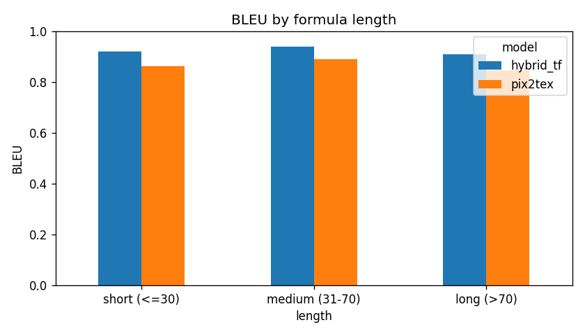
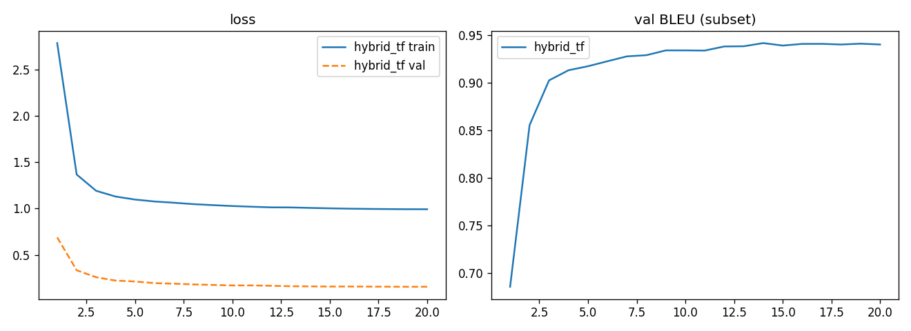

# img2latex: изображение формулы → LaTeX

## Модель

`hybrid_tf` — encoder-decoder на 15.7M параметров, обучен на [im2latex-100k](https://huggingface.co/datasets/yuntian-deng/im2latex-100k) (55k напечатанных формул).

- **Энкодер:** ResNet34 с весами ImageNet (stride 16), затем 4 слоя Transformer encoder с 2D sin-cos позиционным кодированием.
- **Декодер:** 4 слоя Transformer decoder, веса эмбеддингов и выходного слоя общие.
- **Вход:** картинка обрезается по содержимому и приводится к 128×640, в градациях серого.
- **Выход:** последовательность токенов LaTeX, greedy-декодирование.

Для сравнения используется предобученный [pix2tex](https://github.com/lukas-blecher/LaTeX-OCR).

## Результаты

Тест im2latex-100k, 6806 формул. `hybrid_tf` обучался 20 эпох.

| модель | BLEU | edit score | exact match |
|---|---|---|---|
| `hybrid_tf` | **0.933** | **0.952** | **0.592** |
| `pix2tex` (pretrained) | 0.880 | 0.903 | 0.408 |

BLEU по длине формулы (в токенах):

| длина | `hybrid_tf` | `pix2tex` |
|---|---|---|
| короткие (≤30) | 0.921 | 0.862 |
| средние (31–70) | 0.939 | 0.889 |
| длинные (>70) | 0.909 | 0.846 |





Сравнение смещено в пользу `hybrid_tf`: модель училась на im2latex и переняла стиль его разметки, а pix2tex пишет тот же LaTeX иначе, и метрики по токенам штрафуют его за стиль.

## Варианты запуска

Распознать картинку из командной строки (`--photo` выбеливает фон для фото и скриншотов):

```
.venv\Scripts\python predict.py example.png
.venv\Scripts\python predict.py a.png b.png --photo
```

Веб-интерфейс на Gradio, откроется на `http://127.0.0.1:7860`:

```
.venv\Scripts\python app.py --run hybrid_tf
```

Обучение (`--resume` продолжает с последнего чекпойнта):

```
.venv\Scripts\python train.py --run hybrid_tf --epochs 20
```

Оценка на тесте и сравнение моделей, результат в `results/`:

```
.venv\Scripts\python eval.py --run hybrid_tf
.venv-pix2tex\Scripts\python predict_pix2tex.py
.venv\Scripts\python compare.py
```
